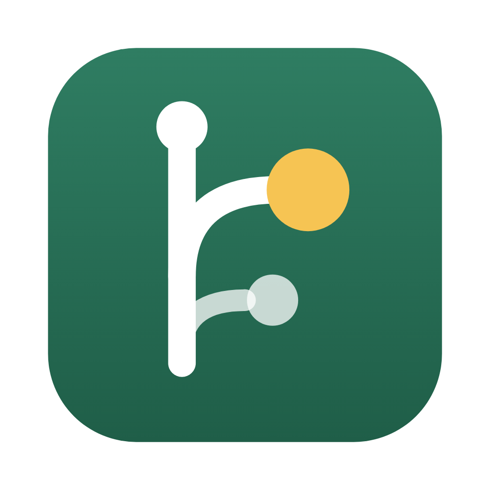
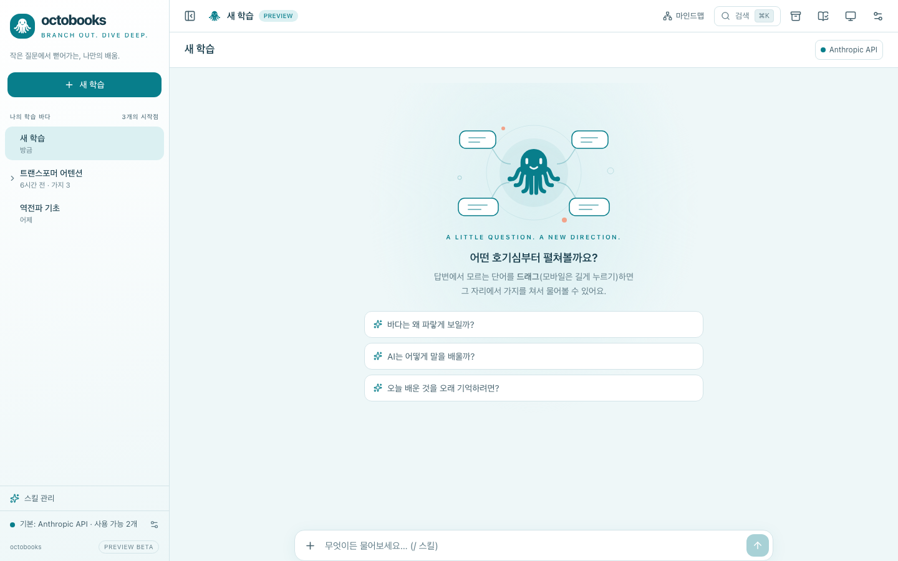

<p align="center">
  <a href="https://github.com/lafin716/octobooks">
    
  </a>
</p>
<h1 align="center">OctoBooks</h1>
<p align="center">오픈 소스 가지치기 학습 채팅. 작은 질문에서 뻗어가는, 나만의 배움.</p>
<p align="center">
  <a href="https://github.com/lafin716/octobooks/releases/latest"></a>
  <a href="https://github.com/lafin716/octobooks/actions/workflows/ci.yml"></a>
  <a href="https://github.com/lafin716/octobooks/releases"></a>
</p>

<p align="center">
  <a href="README.md">English</a> |
  <a href="README.ko.md">한국어</a>
</p>

[](https://github.com/lafin716/octobooks/releases/latest)

---

AI 답변을 읽다가 모르는 단어·문장을 드래그하면 그 자리에서 **가지**가 열립니다. 가지는 부모 맥락을 상속하고, 가지에서 다시 가지를 칠 수 있으며, 이해가 끝나면 **요약 카드**가 부모로 돌아옵니다. 본 대화는 깨끗하게 유지되고, 호기심을 따라간 길은 트리로 남습니다.

### 설치

[GitHub Releases](https://github.com/lafin716/octobooks/releases/latest)에서 최신 빌드를 받으세요.

| 플랫폼                | 파일                                      |
| --------------------- | ----------------------------------------- |
| macOS (Apple Silicon) | `octobooks-<버전>-mac-arm64.dmg`          |
| Windows               | `octobooks-<버전>-win-x64.exe`            |
| Linux                 | `.AppImage` 또는 `.deb`                   |
| Android               | `octobooks-android.apk`                   |

> [!NOTE]
> 아직 코드 서명이 없어 처음 실행할 때 macOS Gatekeeper·Windows SmartScreen 경고가 나옵니다. macOS에서는 앱을 우클릭해 **열기**를 고르세요.

#### 소스에서 실행

```bash
git clone https://github.com/lafin716/octobooks.git
cd octobooks
corepack enable && pnpm install   # Node.js 22+, pnpm 10
pnpm dev                          # 웹 앱 http://localhost:5173
```

데스크톱·모바일·헤드리스 호스트·패키징은 [docs/DEVELOPMENT.ko.md](docs/DEVELOPMENT.ko.md)를 보세요.

### 내 모델 그대로

OctoBooks는 자체 AI 서비스를 운영하지 않습니다. 답변은 다음으로 만듭니다.

- **Claude CLI / Codex CLI** — PC에 본인이 로그인한 공식 CLI (데스크톱 앱 또는 헤드리스 호스트)
- **Anthropic API / OpenAI API** — 본인 API 키, 모든 플랫폼

OAuth 토큰이나 CLI 인증 파일을 읽지 않으며, API 키는 OS 보안 저장소에만 둡니다.

### 기능

- **가지치기** — 어느 텍스트에서나 가지, 깊이 제한 없음, 부모로 돌아오는 요약 카드, 각주형 서브세션
- **보기** — 분할 패널, 플로팅 팝업(모바일은 바텀시트), 마인드맵, 검색, 목차
- **노트** — 답변에 형광펜·색·메모, Markdown·Anki 카드·학습 zip·책으로 내보내기
- **보관함** — 답변·이미지를 페이지에 보관, 페이지 편집기와 발표 모드가 있는 캔버스 보드
- **스킬** — `/quiz`, `/speak`와 직접 만든 SKILL.md 스킬, AI로 스킬·프롬프트 수정
- **지식베이스** — PDF·Markdown·TXT, 폴더, 웹페이지, 공개 GitHub 저장소로 로컬 지식베이스를 만듭니다. 내 PC에서 색인하고(벡터 + 키워드 하이브리드 검색, 서버 없음), 학습에 연결하면 가지도 물려받으며, 답변에 출처를 달아 줍니다
- **그 밖에** — 웹 검색, 첨부, KaTeX 수식, SVG 미리보기, 읽어주기(TTS), 로컬 whisper 음성 입력, 예약·알림
- **어디서나** — 휴대폰·브라우저를 QR로 PC와 페어링(E2E 암호화), 서버에서는 `octobooks serve`
- **내 것으로** — 파일·구글 드라이브·GitHub 백업, 한국어·영어·일본어·중국어·베트남어 화면, 라이트·다크를 고르는 다섯 가지 바다 테마

### 문서

- [개발 안내](docs/DEVELOPMENT.ko.md) — 빌드·실행·패키징·헤드리스 호스트·relay
- [예약](docs/scheduling.md) · [번역 참여](docs/i18n.md)
- 설계 문서: [비전](docs/00-VISION.md), [PRD](docs/01-PRD.md), [아키텍처](docs/02-ARCHITECTURE.md), [Provider](docs/03-PROVIDERS.md), [결정 기록](docs/DECISIONS.md)

### 기여하기

이슈와 PR을 환영합니다. PR 전에 다음을 실행해 주세요.

```bash
pnpm typecheck && pnpm lint && pnpm test && pnpm e2e
```

도메인 로직은 `packages/core`의 순수 함수와 Vitest 테스트로 작성하고, 화면 문구는 한국어·영어·일본어·중국어·베트남어로 번역합니다([docs/i18n.md](docs/i18n.md)).

### 이름

OctoBooks의 예전 이름은 **rhymebook**(그 전에는 **Branch Learn**)입니다. 호환을 위해 일부 내부 이름(`@branch/*`, `RHYMEBOOK_*`, `branch://`)은 그대로 둡니다.

---

**버그를 찾았거나 아이디어가 있나요?** [이슈 열기](https://github.com/lafin716/octobooks/issues)
