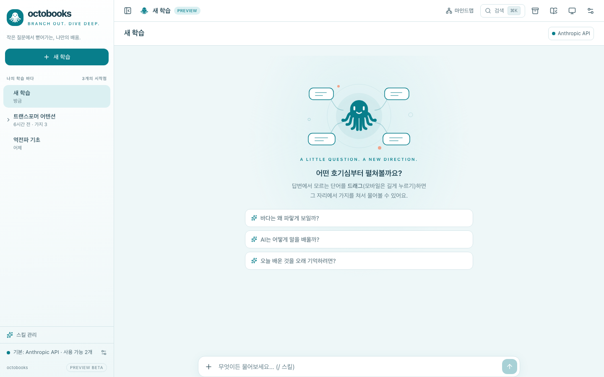

<p align="center">
  <a href="https://github.com/lafin716/octobooks">
    
  </a>
</p>
<h1 align="center">OctoBooks</h1>
<p align="center">The open source branching study chat. Branch out. Dive deep.</p>
<p align="center">
  <a href="https://github.com/lafin716/octobooks/releases/latest"></a>
  <a href="https://github.com/lafin716/octobooks/actions/workflows/ci.yml"></a>
  <a href="https://github.com/lafin716/octobooks/releases"></a>
</p>

<p align="center">
  <a href="README.md">English</a> |
  <a href="README.ko.md">한국어</a>
</p>

[](https://github.com/lafin716/octobooks/releases/latest)

---

While reading an AI answer, drag over any word or sentence you don't understand to open a **branch** right there. The branch inherits its parent's context, branches can branch again, and when you're done a **summary card** flows back to the parent. Your main conversation stays clean, and your whole path of curiosity stays visible as a tree.

### Installation

Download the latest build from [GitHub Releases](https://github.com/lafin716/octobooks/releases/latest).

| Platform              | Download                                  |
| --------------------- | ----------------------------------------- |
| macOS (Apple Silicon) | `octobooks-<version>-mac-arm64.dmg`       |
| Windows               | `octobooks-<version>-win-x64.exe`         |
| Linux                 | `.AppImage` or `.deb`                     |
| Android               | `octobooks-android.apk`                   |

> [!NOTE]
> Builds are not code-signed yet, so macOS Gatekeeper and Windows SmartScreen will show a warning on first launch. On macOS, right-click the app and choose **Open**.

#### From source

```bash
git clone https://github.com/lafin716/octobooks.git
cd octobooks
corepack enable && pnpm install   # Node.js 22+, pnpm 10
pnpm dev                          # web app on http://localhost:5173
```

For desktop, mobile, the headless host and packaging, see [docs/DEVELOPMENT.md](docs/DEVELOPMENT.md).

### Bring your own model

OctoBooks doesn't run its own AI service. Answers come from:

- **Claude CLI / Codex CLI** — your own logged-in official CLI on your PC (desktop app or headless host)
- **Anthropic API / OpenAI API** — your own API key, on every platform

OctoBooks never reads OAuth tokens or CLI auth files, and API keys stay in your OS secure storage.

### Features

- **Branching** — branch from any text, unlimited depth, summary cards back to the parent, footnote sub-sessions
- **Views** — split panels, floating popups (bottom sheets on mobile), mind map, search, table of contents
- **Notes** — highlights, colors and memos on answers; export to Markdown, Anki cards, zip study packs or a book
- **Vault** — save answers and images into pages, with a page editor and a canvas board with presentation mode
- **Skills** — `/quiz`, `/speak` and your own SKILL.md skills; AI-assisted skill and prompt editing
- **Knowledge base** — attach files, links or a GitHub repo to a study; the CLI reads them with read-only tools
- **More** — web search, attachments, KaTeX, SVG preview, text-to-speech, local whisper voice input, schedules and notifications
- **Everywhere** — pair your phone or browser with your PC by QR code (end-to-end encrypted), or run `octobooks serve` on a server
- **Yours** — backups to file, Google Drive or GitHub; Korean / English UI; five ocean themes with light and dark

### Documentation

- [Development guide](docs/DEVELOPMENT.md) — build, run, package, headless host, relay
- [Scheduling](docs/scheduling.md) · [Translating](docs/i18n.md)
- Design docs (Korean): [vision](docs/00-VISION.md), [PRD](docs/01-PRD.md), [architecture](docs/02-ARCHITECTURE.md), [providers](docs/03-PROVIDERS.md), [decisions](docs/DECISIONS.md)

### Contributing

Issues and pull requests are welcome. Before opening a PR, run:

```bash
pnpm typecheck && pnpm lint && pnpm test && pnpm e2e
```

Domain logic lives in `packages/core` as pure functions with Vitest tests; UI text has Korean and English versions ([docs/i18n.md](docs/i18n.md)).

### Name

OctoBooks was formerly **rhymebook** (and **Branch Learn** before that). Some internal names (`@branch/*`, `RHYMEBOOK_*`, `branch://`) are kept for compatibility.

---

**Found a bug or have an idea?** [Open an issue](https://github.com/lafin716/octobooks/issues)
