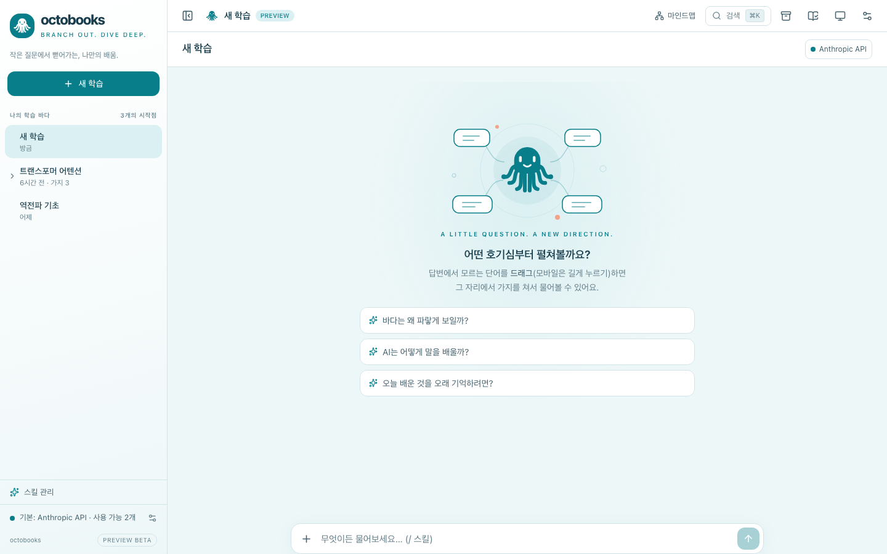
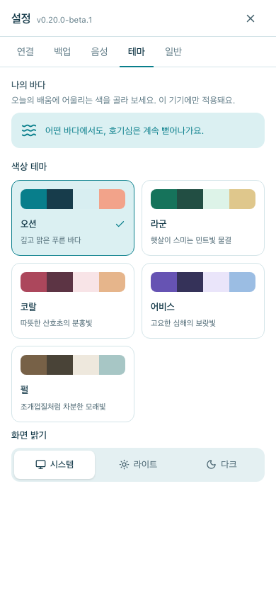
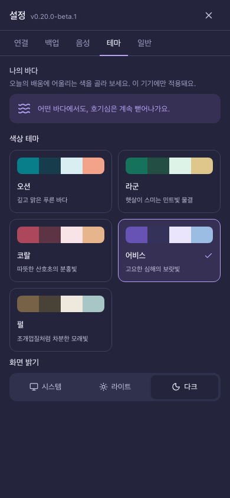

# octobooks preview validation

Worktree `/private/tmp/octobooks-preview`, branch `preview/octobooks`, baseline `e0a9a6259685cb03c949477be606bbe3ccce0430`. Updated 2026-10-16.

## Completed evidence
- Independent architecture review: UI-local palette contract accepted; incorporated explicit preview userData/native install identities, prerelease + not-latest flags and branch protocol coexistence caveat.
- `pnpm typecheck`, `pnpm lint`: pass on complete app and native TypeScript surfaces.
- `pnpm test`: 532 passed, 4 conditional real-CLI/real-server tests skipped (core 399, UI 55, bridge 59, relay 9, server 10). Ran with permission to bind localhost; sandbox-only run failed at listen EPERM, not application assertions.
- `pnpm build`: shared UI, mobile web bundle, desktop renderer/main, bridge, relay, server pass. Existing large-bundle warning remains.
- Full Playwright regression: 77 passed, 11 platform/conditional skips, 58.5s. Includes new 6 appearance cases at desktop/mobile sizes. Expanded final appearance suite: 8 passed, including every palette in light/dark, multiwindow sync, reload, OS-mode change, invalid/blocked storage.
- Desktop/macOS Preview package built via existing electron-builder pipeline, independent bundle name and product id; final rebuilt package smoke PASS: version 0.20.0-beta.1, packaged=true, theme palette and dark mode survive reload, learning session persists, renderer page errors=[]; override and default userData/sessionData both verified. Default is ~/Library/Application Support/octobooks-preview.
- Actual UI screenshots desktop 1440×900, mobile 390×844, tablet 820×1180; empty learning, theme selection, Abyss dark, mindmap. No horizontal page overflow. Captures under `/private/tmp/octobooks-qa/`.
- Browser plugin discovery returned no available browsers. Used repository Playwright in its own temporary profiles for local app QA. No personal browser sessions inspected.
- Independent final adversarial review: no blocking findings. Independent visual review: no clipping/overlap/contrast defects at three sizes after transitions settle. Mobile toolbar title truncates with full title visible below (existing layout constraint).
- Fresh static checks after review amendments: typecheck/lint/diff-check pass.
- Source assets: original SVG glyph and learning-map illustration, generated by existing `scripts/gen-icons.mjs` into all platform icons. No external stock/AI image dependency.

## Remaining
None for requested scope. iOS simulator build PASS; native Info.plist confirms app.octobooks.preview / octobooks Preview / 0.20.0.

## Known limits
Unsigned desktop builds when signing secrets absent. iOS device/store distribution is not part of existing release pipeline. The compatible branch:// scheme is shared; use QR/manual pairing when installed alongside stable. Existing headless alias shares server data path and does not run automatically in Preview. Existing Anki deck and JSON format identifiers intentionally retained. Fixed legacy OMX subagent models are unavailable in this account; implementation ran in leader, separate Compound architecture/correctness reviewers used supported inherited model.

## Screenshots (isolated demo data)

Additional Linux CI on source 9eaf5f8 initially failed an untouched sync.test.ts assertion: sync.reset wait observes new hello plus stale loaded flag while state remains connecting, before the new snapshot arrives. Local full and final core tests pass; no sync implementation changed. The single same-source rerun passed; all Linux CI jobs now pass. No sync implementation or test was changed.

## Published beta

- Source commit: `9eaf5f8f97b0c03e533e422f7e18fdc2a1e7ea63`, annotated tag `v0.20.0-beta.1`. Later branch commit only synchronizes this evidence; installer source stays the reviewed tag.
- [Release](https://github.com/lafin716/rhymebook/releases/tag/v0.20.0-beta.1): published, draft=false, prerelease=true, latest=false.
- [Release CI](https://github.com/lafin716/rhymebook/actions/runs/38865307519): all macOS/Windows/Linux/Android builds and publication successful.
- [Verification CI](https://github.com/lafin716/rhymebook/actions/runs/38865391006): typecheck/lint/test and E2E successful on the same source; 532 unit/integration tests passed, 4 conditional skips, 79 E2E passed, 11 conditional/platform skips.
- Seven assets: mac arm64 DMG + ZIP; Windows x64 EXE; Linux x86_64 AppImage + amd64 DEB; signed Android APK + AAB.
- Downloaded CI mac ZIP, extracted and actually launched: version 0.20.0-beta.1, app.octobooks.preview, packaged=true; palette/mode/session survive reload; page errors empty; both default and temporary userData/sessionData verified.
- Downloaded CI APK checked with aapt: app.octobooks.preview, versionCode21, versionName0.20.0-beta.1, label octobooks Preview. iOS simulator built; version0.20.0/build21, independent bundle ID confirmed.
- Windows/Linux installer builds verified in CI; actual GUI smoke was macOS. Native Android metadata and shared mobile UI verified; no claim of Windows/Linux device or TestFlight validation.
- Local AND remote main remain `e0a9a6259685cb03c949477be606bbe3ccce0430`; original checkout clean, still on main. Existing Latest release remains v0.19.0.

## Continue / development

Use this worktree/branch; never merge into main without a new request. `pnpm dev --port 5196` opens the preview UI. `pnpm --filter @branch/desktop package:dir` rebuilds the separate octobooks Preview bundle. Palette settings: desktop Settings → 테마; remote Settings → 나의 바다. Existing data transfer uses backup export/import. Test commands and ownership contracts are in TEST_STRATEGY.md and MASTER_PLAN.md.
